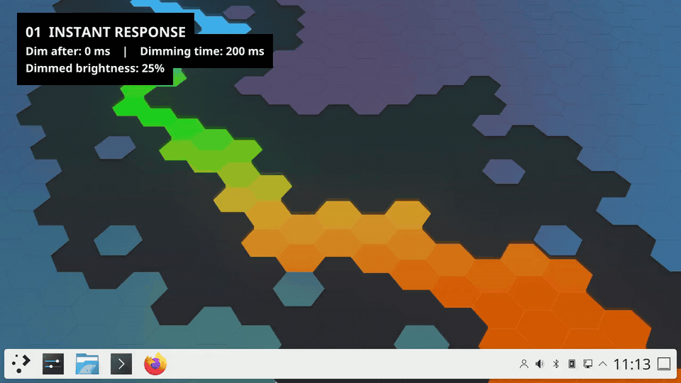

# OLED HDR Panel Saver

Dims the Plasma panel brightness when idle independently of overall brightness settings to prevent OLED burn-in. Works best in HDR mode.

Hovering, touching, or clicking the panel restores full brightness instantly with a fast fade (unless configured to remain dimmed at all times).

Requires KWin 6.7 or newer, including support for the KWin 6.8 painting API.

Fedora, openSUSE, Arch and Ubuntu packages require the exact KWin version used to build the effect.
A KWin update may be held until a compatible rebuild is available.

## Demo

[](docs/demo/oled-panel-demo-60fps.mp4)

[Watch or download the MP4](docs/demo/oled-panel-demo-60fps.mp4) · 20 seconds, 1280×720, 60 fps.

## Install

### Fedora

```bash
sudo dnf copr enable deno/kwin-effects-hdr-oled-saver
sudo dnf install -y kwin-effects-hdr-oled-saver
```

### openSUSE Tumbleweed / Slowroll

```bash
# Tumbleweed
sudo zypper addrepo https://download.opensuse.org/repositories/home:/deno_:/kwin-effects-hdr-oled-saver/openSUSE_Tumbleweed/home:deno_:kwin-effects-hdr-oled-saver.repo
# Slowroll
sudo zypper addrepo https://download.opensuse.org/repositories/home:/deno_:/kwin-effects-hdr-oled-saver/openSUSE_Slowroll/home:deno_:kwin-effects-hdr-oled-saver.repo

sudo zypper refresh
sudo zypper install kwin-effects-hdr-oled-saver
```
### Arch Linux

Import and trust the repository key:

```bash
# 1. Fetch and add the OBS repo key to pacman's keyring
curl -fsSL https://download.opensuse.org/repositories/home:/deno_:/kwin-effects-hdr-oled-saver/Arch_Extra/x86_64/home_deno__kwin-effects-hdr-oled-saver_Arch_Extra.key | sudo pacman-key --add -

# 2. Locally sign (trust) the key
sudo pacman-key --lsign-key $(curl -fsSL https://download.opensuse.org/repositories/home:/deno_:/kwin-effects-hdr-oled-saver/Arch_Extra/x86_64/home_deno__kwin-effects-hdr-oled-saver_Arch_Extra.key | gpg --show-keys --with-colons | awk -F: '$1=="pub"{print $5}')
```

Add the repository to `/etc/pacman.conf`:

```ini
[home_deno__kwin-effects-hdr-oled-saver_Arch_Extra]
Server = https://download.opensuse.org/repositories/home:/deno_:/kwin-effects-hdr-oled-saver/Arch_Extra/$arch
```

Then install:

```bash
sudo pacman -Sy kwin-effects-hdr-oled-saver
```

### Ubuntu

Ubuntu 26.10 (including Kubuntu) packages are built for amd64, arm64, and
amd64v3 on [Launchpad](https://launchpad.net/~denopl/+archive/ubuntu/kwin-effects-hdr-oled-saver):

```bash
sudo add-apt-repository ppa:denopl/kwin-effects-hdr-oled-saver
sudo apt update
sudo apt install kwin-effects-hdr-oled-saver
```

### openSUSE Leap

Support planned for Leap 16.1 (requires KWin $\ge$ 6.7.0).

## Running

Enable the effect in System Settings under Desktop Effects.

Restart KWin (`kwin_wayland --replace & disown`) or logout & login from the KDE desktop so the effect loads.

## Screenshots


